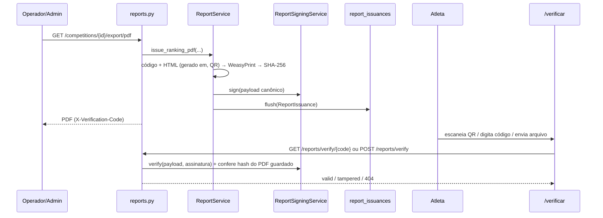

# ADR-012 — PDFs de ranking assinados: registro de emissões + Ed25519 + verificação pública

**Status:** Aceito
**Data:** 2026-10-22

---

## Contexto

Falhas na inicialização de timers obrigaram ajustes manuais de tempo (ADR-011). Alguns
atletas alegaram manipulação de dados. O PDF de ranking não mostrava *por que* um
tempo foi alterado, *quando* o documento foi gerado, nem permitia provar que um PDF
circulando (WhatsApp, redes sociais) era o mesmo emitido pela organização.

## Decisão

1. **Coluna "Justificativa"** no PDF do ranking de tempo: texto + data/hora do
   **último** evento `adjusted` do timer (`"<texto> — ajustado em DD/MM/AAAA HH:MM"`);
   `—` quando não houve ajuste. Vem de `RankingEntry.adjustment_note`/`adjusted_at`.
2. **"Gerado em DD/MM/AAAA HH:MM:SS (horário de Brasília)"** no topo dos dois PDFs
   (ranking de tempo e Leaderboard WODs).
3. **Cada exportação vira uma emissão** em `report_issuances` (append-only):
   código de verificação aleatório (`secrets.token_urlsafe(16)`), SHA-256 dos bytes
   finais, snapshot de competição/categoria/papel do emissor, os próprios bytes do PDF
   e uma **assinatura Ed25519** sobre o payload canônico (JSON, chaves ordenadas):
   `code, report_type, competition_id, competition_name, category_id, category_name,
   issued_at, issued_by_user_id, issued_by_role, sha256`.
4. O PDF leva o código no rodapé de toda página e um **QR code** para
   `{FRONTEND_URL}/verificar/{código}`.
5. **Verificação pública** (sem login, com rate limit):
   - `GET /api/v1/reports/verify/{code}` → metadados + status;
   - `POST /api/v1/reports/verify` (upload) → busca pelo SHA-256 do arquivo;
   - `GET /api/v1/reports/verify/{code}/pdf` → original (só se íntegro);
   - `GET /api/v1/reports/public-key` → chave pública PEM.
6. **Status `valid` | `tampered`.** `valid` exige assinatura conferindo **e**
   `sha256(pdf_data) == sha256`. Sem a segunda checagem, alguém com acesso ao banco
   trocaria o PDF guardado sem tocar na assinatura.
7. Competição com emissões **não pode ser excluída** (409; FK `RESTRICT`).
8. Sem WeasyPrint → 503 (o antigo fallback em HTML foi removido: um "documento
   assinado" em HTML quebraria a promessa). Sem chave → 500 com erro explícito,
   nunca PDF sem assinatura.

### Limite da garantia

O hash de um arquivo não pode estar dentro dele — por isso o PDF leva só o código, e o
hash fica no servidor. A assinatura prova que **aquele arquivo foi emitido pelo Tempus
naquele momento e não foi alterado depois**. Ela **não** prova que os dados estavam
corretos antes da emissão: isso é coberto pela coluna de justificativa e por
`audit_logs` (ADR-011).

## Gestão da chave

- `REPORT_SIGNING_PRIVATE_KEY`: 32 bytes Ed25519 em base64, gerada com
  `python scripts/generate_report_signing_key.py`. Base64 (e não PEM) porque PEM é
  multilinha e quebra no `env_file` do docker-compose.
- **Trocar ou perder a chave invalida a verificação de todos os PDFs já emitidos**
  (passam a aparecer como `tampered`). Trocar só em caso de vazamento; manter backup
  seguro fora do servidor.

## Alternativas descartadas

- **Assinatura PAdES embutida (pyHanko)**: com certificado autoassinado o leitor de PDF
  mostra "identidade desconhecida" (piora a desconfiança); validade jurídica exige
  certificado ICP-Brasil A1 pago. Pode ser somada no futuro sem mudar este registro.
- **HMAC com chave derivada do `SECRET_KEY`**: simétrico — ninguém fora do servidor
  verifica, e misturaria a chave de cookies com a de documentos.
- **Só o hash no banco**: quem altera o banco altera a "prova".

## Consequências

- Nova tabela `report_issuances` (migration `20261022_report_issuances`); cada PDF
  ocupa algumas dezenas de KB no banco.
- Dependências novas: `cryptography`, `segno`, `tzdata`.
- Deploy desta versão exige configurar `REPORT_SIGNING_PRIVATE_KEY`; sem ela a
  exportação de PDF responde 500.
- Exportar PDF de competição inexistente passou a responder 404 (antes gerava PDF
  vazio com título "Competição #id").
- `issued_by_user_id` **não tem FK** (só snapshot inteiro): o id entra na assinatura, e
  um `ON DELETE SET NULL` faria todo PDF de um usuário excluído aparecer como adulterado.
- As rotas de exportação usam `Depends(get_db, scope="function")`: o commit da emissão
  acontece antes do envio do PDF (com o escopo padrão, uma falha de commit entregaria um
  PDF cujo código não existe). Exige `fastapi>=0.154`.
- Cada exportação grava um PDF novo; a tabela só cresce (sem política de retenção).
- As garantias da rota pública dependem da infraestrutura: o nginx precisa de
  `client_max_body_size` compatível com o limite de 10 MB, e o rate limit por IP só
  funciona se o uvicorn confiar no `X-Forwarded-For` do proxy (`--forwarded-allow-ips`).
