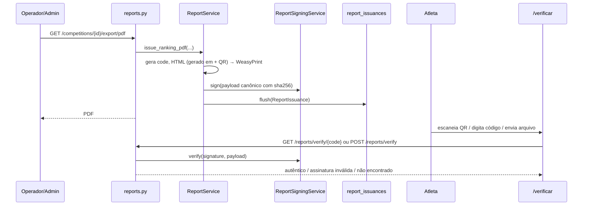

# PDF de Ranking Assinado — Design

**Data:** 2026-10-22 · **Branch:** `feat/ranking-pdf-assinado` · **Status:** aprovado em conversa, aguardando revisão da spec

## Contexto

Falhas na inicialização de timers obrigaram ajustes manuais de tempo
(`POST /timers/{id}/adjust`, ADR-011). Alguns atletas alegaram manipulação de dados.
Objetivo: dar transparência e prova de integridade aos PDFs de ranking emitidos.

## Objetivos

1. Coluna **Justificativa** no PDF do ranking de tempo, com o motivo e a data/hora do
   **último** ajuste do timer (`"<texto> — ajustado em DD/MM/AAAA HH:MM"`); `—` quando
   não houve ajuste.
2. **Data e hora de geração** em todo PDF de ranking (horário de Brasília).
3. **Assinatura digital** que permita a qualquer pessoa verificar, no Tempus, que um PDF
   foi emitido pelo sistema e não foi alterado.

Os itens 2 e 3 valem para os dois PDFs: ranking de tempo (`/export/pdf`) e
Leaderboard WODs (CrossFit). O item 1 vale só para o ranking de tempo.

## Fora de escopo

- Assinatura PAdES embutida no PDF / certificado ICP-Brasil.
- Coluna de justificativa na tela de ranking ao vivo (o campo existirá na API).
- Histórico completo de ajustes no PDF (só o último).
- Assinar o PDF de certificado de participação.

## Limite da garantia (deixar explícito na ADR)

O hash de um arquivo não pode estar dentro dele. O PDF leva só um **código de
verificação** + QR; o SHA-256 dos bytes finais fica no servidor. A assinatura prova que
*aquele arquivo foi emitido pelo Tempus naquele momento e não foi alterado depois* — não
que os dados estavam corretos antes da emissão. Isso é coberto pela coluna de
justificativa e pelo `audit_logs`.

## Arquitetura

### Modelo `ReportIssuance` (`app/models/report_issuance.py`, tabela `report_issuances`)

| Coluna | Tipo | Observação |
|---|---|---|
| `id` | int PK | |
| `verification_code` | `String(32)`, unique, index | `secrets.token_urlsafe(16)` (22 chars) |
| `report_type` | `String(32)` | `ranking` \| `wod_leaderboard` (constantes) |
| `competition_id` | FK `competitions.id` | `ondelete=RESTRICT` — emissão não some com a competição |
| `category_id` | int, nullable | sem FK (categoria pode ser removida; o registro é histórico) |
| `issued_by_user_id` | int, nullable | **sem FK**: o id é assinado; um `SET NULL` invalidaria a assinatura ao excluir o usuário (achado da revisão) |
| `issued_at` | datetime (UTC) | definido pela aplicação antes de assinar (não `server_default`), pois entra no payload |
| `sha256` | `String(64)` | hex dos bytes finais do PDF |
| `signature` | `String(128)` | Ed25519, base64 |
| `pdf_data` | `LargeBinary`, `deferred=True` | original para download |
| `created_at` / `updated_at` | padrão do projeto | |

Migration Alembic nova, revision ID ≤ 32 caracteres, com `downgrade()`.
Registro imutável: o repositório não expõe update/delete.

### `ReportSigningService` (`app/services/report_signing.py`)

- Chave privada Ed25519 (PEM) em `settings.REPORT_SIGNING_PRIVATE_KEY` (opcional no
  `Settings`; ausência → `ReportSigningKeyMissingError` na emissão, nunca PDF sem assinatura).
- `build_payload(issuance) -> bytes`: JSON canônico (`sort_keys=True`,
  `separators=(",", ":")`) com `code`, `report_type`, `competition_id`, `category_id`,
  `issued_at` (ISO 8601 UTC), `issued_by_user_id`, `sha256`.
- `sign(payload) -> str` (base64) e `verify(payload, signature) -> bool`.
- `public_key_pem() -> str`.
- Script `backend/scripts/generate_report_signing_key.py` imprime um par novo.
- Dependência: `cryptography` (com teto de versão maior, conforme lição do SQLAlchemy).

### `ReportService` (`app/services/report.py`)

Extrai a montagem de HTML que hoje vive inline em `app/api/v1/reports.py` (viola a
separação de camadas). Funções principais:

- `issue_ranking_pdf(db, competition_id, category_id, issued_by) -> ReportIssuance`
- `issue_wod_leaderboard_pdf(db, competition_id, category_id, issued_by) -> ReportIssuance`

Fluxo comum (`_issue_pdf`): gera `verification_code` e `issued_at` → renderiza HTML com
cabeçalho *"Gerado em DD/MM/AAAA HH:MM:SS (horário de Brasília)"* e rodapé com código,
URL `{FRONTEND_URL}/verificar/{code}` e QR (SVG inline via `segno`) → WeasyPrint com
`url_fetcher` bloqueado → SHA-256 → assinatura → `ReportIssuanceRepository.create`
(só `flush`). Router apenas devolve `issuance.pdf_data`.

WeasyPrint ausente → `PdfRendererUnavailableError` → **503** (remove o fallback HTML
desses dois endpoints: um "documento assinado" em HTML quebraria a promessa).

Fuso: `REPORT_TIMEZONE = "America/Sao_Paulo"` em `core/constants.py`; dependência
`tzdata` para a imagem Docker.

### Justificativa no ranking

`RankingEntry` ganha `adjustment_note: str | None` e `adjusted_at: datetime | None`,
preenchidos em `RankingService.get_ranking` a partir do `TimerEvent` de tipo `adjusted`
de maior `id` (eventos já carregados via `selectinload`). Coluna nova na tabela do PDF,
com quebra de linha e fonte menor.

### Endpoints públicos (`app/api/v1/reports.py`, sem autenticação)

| Método | Rota | Resposta |
|---|---|---|
| GET | `/api/v1/reports/verify/{code}` | `ReportVerificationResponse`: `status` (`valid` \| `invalid_signature`), tipo, competição (nome), categoria (nome), `issued_at`, `issued_by_role`, `sha256`; 404 se não existir |
| GET | `/api/v1/reports/verify/{code}/pdf` | PDF original (só se assinatura válida; senão 409) |
| POST | `/api/v1/reports/verify` | upload multipart; calcula SHA-256 e busca emissão por hash → mesma resposta ou 404 |
| GET | `/api/v1/reports/public-key` | PEM da chave pública |

Emissor exibido só pelo papel (ex.: "Administração"), sem nome.
Assinatura inválida → `logger.warning` com código.

### Segurança

- `@limiter.limit` nos endpoints públicos (constante, ex.: `30/minute`).
- Upload: máx. 10 MB (`REPORT_VERIFY_MAX_UPLOAD_BYTES`), exige prefixo `%PDF`, não é
  parseado nem armazenado.
- Chave privada nunca no repositório; `.env.example` só com placeholder + instrução.
- Exportação continua restrita a `operator`/`admin`.

## Frontend

- `src/api/reports.ts`: `verifyByCode`, `verifyByFile`, `originalPdfUrl`.
- `src/pages/VerifyReportPage.tsx`, rotas públicas `/verificar` e `/verificar/:code`:
  - com código: estados ✅ autêntico (metadados, hash, botão **Baixar original**),
    ⚠️ assinatura inválida, ❌ não encontrado;
  - sem código: campo para digitar código + upload de arquivo PDF.
- Tipos em `src/types/` (`ReportVerification`, `status` tipado como união literal).
- `RankingPage` inalterada (links de download continuam iguais).

## Testes

**Unit**
- `ReportSigningService`: assina/verifica; payload alterado → inválido; outra chave →
  inválido; chave ausente → erro explícito.
- Ranking: `adjustment_note`/`adjusted_at` do último ajuste; `None` sem ajuste.

**Integration**
- Export PDF (ranking e WOD) cria `ReportIssuance`; SHA-256 gravado = bytes entregues.
- PDF contém "Gerado em" e o código (via texto do HTML renderizado / mock do renderer).
- `GET verify/{code}` sem login → `valid`; download do original = bytes idênticos.
- `POST verify` com o mesmo arquivo → `valid`; com 1 byte alterado → 404; não-PDF → 422;
  acima do limite → 413.
- `sha256` adulterado no banco → `invalid_signature`; download → 409.
- Competitor exportando → 403; WeasyPrint indisponível → 503; chave ausente → 500
  com erro explícito logado.

Se o WeasyPrint não renderizar no ambiente de teste, o renderer é isolado numa função
mockável e o restante da cadeia é testado normalmente.

## Documentação

- `docs/ADR/012-assinatura-relatorios-pdf.md` (decisão Ed25519 + registro, limite da
  garantia, alternativas PAdES/HMAC descartadas).
- README / `.env.example`: geração e guarda da chave `REPORT_SIGNING_PRIVATE_KEY`.
- Memória do projeto atualizada ao final.
